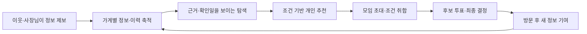
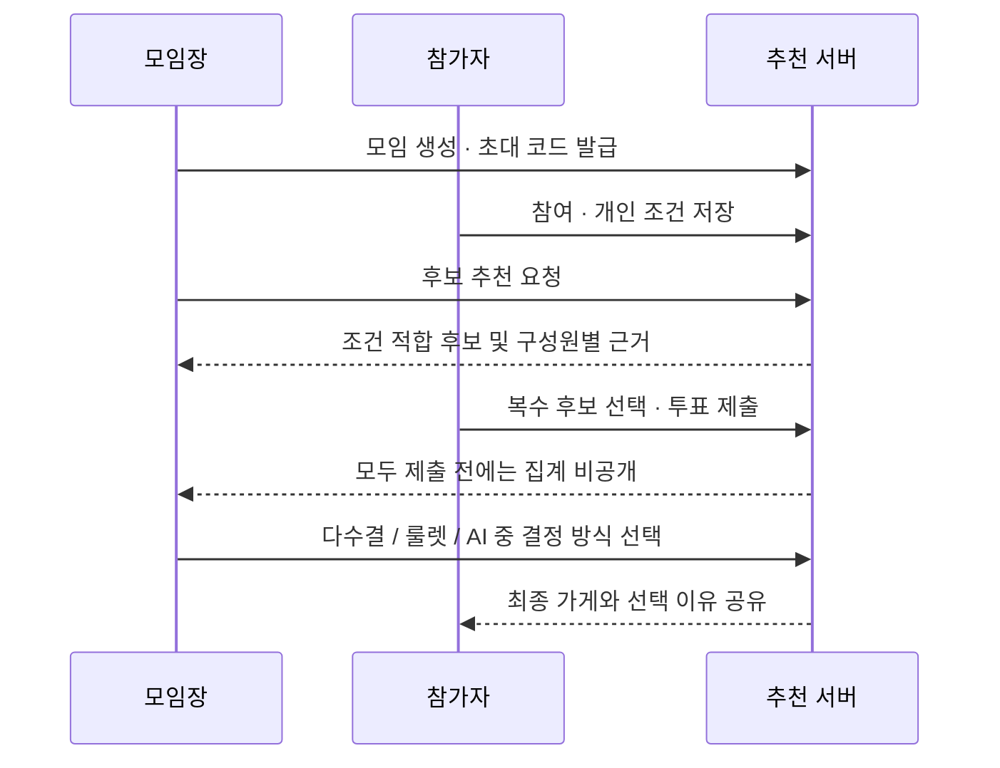
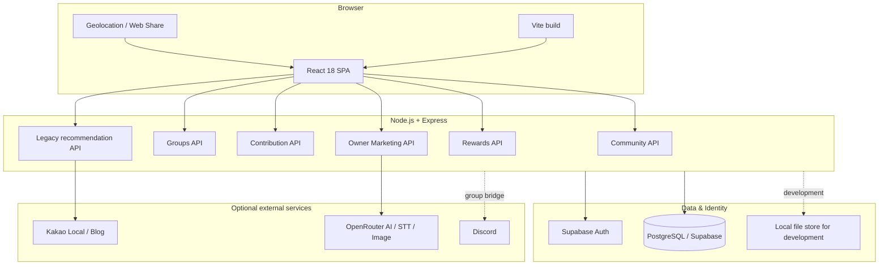

# 월계밥상 (Wolgye Bapsang)

> **작은 발견이 모이는 동네.**  
> 월계1동의 주민·방문자·사장님이 함께 최신 가게 정보를 쌓고, 그 근거를 바탕으로 식사 장소를 찾고 합의하는 하이퍼로컬 커뮤니티 플랫폼


## 프로젝트 한눈에 보기

월계밥상은 단순히 “어디가 맛있어?”를 답하는 추천 서비스가 아닙니다. 지역 가게의 메뉴·가격·영업 정보와 이웃의 방문 경험을 **관찰 시점·출처·확인 상태**와 함께 관리하고, 이를 바탕으로 개인 검색과 여러 사람이 함께하는 식사 결정을 지원합니다.

지역 상권 정보는 빨리 낡고, 조건이 복잡할수록 일반 검색만으로는 판단하기 어렵습니다. 이 프로젝트는 이 문제를 다음의 연결된 흐름으로 풀어냅니다.



| 구분 | 내용 |
| --- | --- |
| 문제 | 가격, 메뉴, 영업 여부처럼 변하는 동네 정보를 신뢰 가능한 맥락과 함께 찾기 어렵고, 여러 명의 식사 조건을 합의하기 어렵습니다. |
| 사용자 | 월계1동 주민·방문자, 가게 사장님, 운영자 |
| 핵심 가치 | 정보의 최신성·근거를 드러내고, 확인되지 않은 내용을 사실처럼 추천하지 않습니다. |
| 대표 시나리오 | 이웃이 메뉴/가격을 제보 → 다른 사용자가 예산·음식 조건으로 탐색 → 친구와 후보에 투표 → 사장님은 승인 후 홍보 캠페인과 플랫폼 내 조회 지표를 확인 |

## 핵심 기능

### 1. 신뢰 맥락을 갖춘 동네 가게 탐색

- 월계1동 경계와 좌표를 기준으로 가게 목록을 구성하고, 카테고리·키워드·이름으로 탐색합니다.
- 현재 위치 권한을 받은 경우 사용자 위치 기준 거리순 정렬과 이동 추정 정보를 제공합니다.
- 가게 상세에는 메뉴, 가격, 영업 정보, 이웃 소식, 사장님 캠페인, 배달 링크를 함께 보여줍니다.
- 이웃이 등록한 장소는 별도로 표시하고, 미확인 정보와 확인된 정보를 구분합니다.
- 예산·시간처럼 근거가 필요한 조건은 정보가 없으면 “충족”으로 처리하지 않고, 확인이 필요하다고 알립니다.

### 2. 조건 기반 추천 — ‘모르는 것은 모른다고’ 말하는 추천

사용자는 “만원 이하의 혼밥”, “근처 한식”, “매운 음식은 빼고”처럼 자연어로 조건을 입력합니다. 서버는 명시된 조건만 구조화하고, 등록된 가게 정보 및 날짜가 있는 제보를 근거로 후보를 고릅니다.

- 예산, 메뉴 선호/제외, 방문 시간, 인근 여부 등 명시된 조건을 해석합니다.
- 필수 조건 위반 가게는 후보에서 제외합니다.
- 가격·빠른 제공 등 근거가 없는 조건은 확정 충족으로 표시하지 않습니다.
- 오래되었지만 관련 있는 제보와, 새롭지만 무관한 제보를 구분해 검색 관련성을 유지합니다.
- 요청한 복수 음식 카테고리가 있으면 카테고리별 가까운 후보를 포함할 수 있도록 정렬합니다.
- 추천 근거는 실제 관찰 날짜가 있는 제보만 인용하고, 확인되지 않은 조건은 화면에서 드러냅니다.

### 3. 이웃 참여형 정보 갱신과 소식 피드

가게 정보는 운영자가 일방적으로 입력하는 데이터가 아니라 지역 사용자가 함께 다듬는 데이터입니다.

- 새 가게를 이름·위치·사진과 함께 제안할 수 있으며, 중복·지역 범위·이미지 형식을 검증합니다.
- 메뉴판 사진과 메뉴·가격, 영업 정보, 방문 경험을 가게에 연결해 등록·수정할 수 있습니다.
- 글은 관찰일과 작성자 역할(이웃/사장님)을 표시하고, 이미지 첨부는 JPG·PNG·WebP 및 1MB 제한을 둡니다.
- 작성한 소식은 링크 공유(Web Share API)하거나 클립보드로 복사할 수 있으며, 배포 환경에서는 게시글별 미리보기 메타데이터를 생성합니다.
- 기여·수정 이력을 보존하고, 작성자는 자신의 글을 수정·삭제할 수 있습니다. 다른 이웃의 글과 이웃 등록 장소 삭제는 관리자만 가능합니다.

### 4. 여러 명의 식사 결정을 위한 모임·투표

모임장은 식사 모임을 만들고 초대 코드로 최대 12명의 참가자를 받을 수 있습니다. 각 참가자는 자기 조건을 입력하고, 원하면 다른 참가자에게는 비밀 조건으로 숨길 수 있습니다.



- 참가자별 예산·선호·제외 조건을 함께 고려해 후보를 생성합니다.
- 누군가의 조건을 위반하는 가게는 추천하지 않으며, 후보별 구성원 충족 여부를 설명합니다.
- 참가자가 직접 제안한 가게는 동점 수준의 적합 후보 사이에서 우선할 수 있지만, 조건을 무시하지는 않습니다.
- 후보가 바뀌거나 조건이 수정되면 이전 투표를 무효화해 오래된 선택이 확정되지 않도록 합니다.
- 모든 참가자가 제출하기 전에는 투표 수를 숨깁니다.
- 모임장은 과반수, 투표된 후보 중 룰렛, 투표된 후보 중 AI 선택의 세 방식으로 최종 결정을 낼 수 있습니다.
- Discord 봇 연동 스크립트와 그룹 브리지가 포함되어 웹과 Discord의 참여 상태를 연결할 수 있습니다.

### 5. 사장님 전용 AI 마케팅 워크스페이스

사장님 기능은 단순 광고 등록이 아니라, **승인된 가게 계정만 소비자 화면에 캠페인을 게시**하게 설계했습니다.

- 로그인한 사용자가 등록 가게의 관리 권한을 신청하고, 관리자가 실제 소유 확인 후 승인합니다.
- AI 홍보 대화, 음성 녹음 전사(STT), 홍보 문안·카드 이미지 제안을 지원합니다.
- 생성 제안은 검토·승인 상태를 거쳐 캠페인에 연결됩니다. 승인한 콘텐츠만 게시할 수 있습니다.
- 빠른 게시, 캐러셀형 콘텐츠, 포스터 카드, 가게별 키워드, 배달앱 공유 링크, 최대 5개 쿠폰을 관리합니다.
- 가게 상세 조회를 익명 방문자 쿠키 기준으로 기록해 최근 90일 플랫폼 내 조회 현황을 봅니다. 이는 실제 방문·매출·구매 전환 지표가 아닙니다.
- 이미지 생성과 전사·AI 요청에는 서버 측 호출, 입력 검증, 요청 횟수 제한을 적용합니다.

### 6. ‘골목냥’ 기여 리워드

정보를 남기는 행동이 지역 데이터의 최신성으로 이어지도록 가벼운 게임화 요소를 더했습니다.

- 로그인 사용자는 출석, 검증 가능한 정보 기여 등으로 `밥알`을 얻습니다.
- 같은 장소의 중복 보상과 일별 적립량을 제한합니다.
- 밥알을 먹여 고양이 레벨을 올리고, 레벨 조건을 충족한 가게 쿠폰을 한 번 사용할 수 있습니다.
- 게시글이 삭제되면 그 게시글에 연결된 보상도 회수합니다.

## 사용자 경험 설계

| 화면 | 주요 경험 |
| --- | --- |
| 오늘의 골목 | 지역 최신 소식 피드, 오늘의 현황, 빠른 글쓰기, 대표 캐러셀 |
| 장소 찾기 | 자연어 조건 탐색, 필터·정렬, 거리/이동 정보, 근거가 있는 추천 |
| 동네 발견 | 가게 카탈로그 탐색, 저장, 장소 제안, 정보 기여 |
| 모임 | 초대 코드, 개인/비밀 조건, 후보 제안, 복수 투표, 최종 결정 |
| 가게 상세 | 최신 소식·메뉴·가격·영업 정보·배달 링크·사장님 홍보 콘텐츠 |
| 골목냥 키우기 | 출석·기여 보상, 레벨, 쿠폰 해금 및 사용 |
| 마이페이지 | 프로필, 내 글, 저장한 가게, 방문 기록, 사장님 공간 진입 |
| 사장님 공간 | 권한 신청/승인, AI 콘텐츠 제작, 캠페인, 쿠폰, 키워드, 성과 리포트 |

모바일 하단 내비게이션과 데스크톱 사이드 내비게이션을 모두 제공하며, 위치 권한이 없는 환경이나 로그인하지 않은 상태에서도 가능한 탐색은 막지 않습니다. 다만 글 작성·개인 기록·리워드·사장님 기능처럼 계정이 필요한 동작은 로그인 흐름으로 연결합니다.

## 기술 아키텍처



### 프론트엔드

- **React 18 + Vite**: 컴포넌트 단위의 커뮤니티 UI와 빠른 개발·프로덕션 번들링
- **Tailwind CSS / CSS**: 기존 대화형 화면과 커뮤니티 화면의 반응형 스타일 구성
- **Leaflet**: 위치·지도 표현 기반
- **Lucide React**: 일관된 아이콘 UI
- **브라우저 API**: Geolocation으로 거리 정렬, Web Share/Clipboard로 게시글 공유, MediaRecorder 기반 음성 입력 보조

### 백엔드

- **Express (ESM)**: REST API, 입력 검증, 정적 SPA 서빙, Vercel Function 어댑터
- **Supabase Auth**: 사용자 인증 및 관리자/사장님 권한 판별
- **PostgreSQL (`pg`)**: 장소, 게시글, 모임, 기여, 사용자 데이터, 사장님 캠페인·쿠폰·통계의 공용 저장
- **PGlite**: 테스트 및 로컬 데이터 경로 지원
- **CORS / dotenv**: 개발 환경 통신과 서버 전용 비밀값 관리

### 배포 구조

Vercel 설정은 `/api/*` 요청을 하나의 Express Function으로 전달하고, 그 외 경로는 SPA 엔트리로 재작성합니다. 프로덕션에서는 빌드 산출물을 Express가 서빙하며, 게시글 공유 URL에 맞는 Open Graph 미리보기를 반환합니다.

## API 맵

아래는 구현된 API의 기능 단위 요약입니다. 모든 변경 API는 서버에서 입력 값, 권한 또는 요청 한도를 점검합니다.

| 영역 | 대표 엔드포인트 | 설명 |
| --- | --- | --- |
| 상태 | `GET /api/health` | 서버, AI 모델, Kakao 키 구성 상태 확인 |
| 인증·개인화 | `GET /api/auth/config`, `GET /api/auth/me`, `GET/PUT /api/me/data` | Supabase 클라이언트 구성, 현재 계정, 저장·방문 데이터 |
| 가게·추천 | `GET /api/community/places`, `POST /api/community/search`, `POST /api/community/recommend` | 가게 목록, 검색, 근거 기반 조건 추천 |
| 기여·소식 | `/api/community/places`, `/api/community/posts`, `/api/community/contributions` | 가게 제안, 메뉴 사진, 정보 수정, 게시글 CRUD, 기여 현황 |
| 모임 | `/api/groups`, `/api/groups/:id/join`, `condition`, `suggestions`, `recommend`, `vote`, `finalize` | 생성·참여부터 조건 취합, 후보, 비공개 집계, 최종 결정까지 |
| 리워드 | `GET /api/rewards`, `POST /checkin`, `POST /feed`, `POST /coupons/:id/use` | 밥알·레벨·쿠폰 상태 및 사용 |
| 사장님 | `/api/owner/register`, `campaigns`, `proposals`, `coupons`, `keywords`, `report` | 계정 승인, AI 제안, 캠페인, 쿠폰, 키워드, 조회 리포트 |
| 초기 AI 화면 | `POST /api/chat`, `POST /api/share/prepare`, `GET /api/restaurants` | 레거시 대화형 식당 추천·공유 준비·Kakao 장소 검색 |

## 데이터 신뢰성 및 권한 설계

이 프로젝트의 중요한 설계 원칙은 **추천 엔진이 데이터의 빈칸을 임의의 사실로 메우지 않는 것**입니다.

| 대상 | 적용한 원칙 |
| --- | --- |
| 장소 정보 | 이웃 등록 여부, 관찰일, 근거·확인 상태, 변경 이력을 다룹니다. |
| 추천 | 명시 조건을 임의로 완화하지 않고, 근거 없는 가격/시간 정보는 충족 판정에 쓰지 않습니다. |
| 모임 조건 | 비밀 조건은 당사자 외 사용자에게 내용 대신 ‘비밀 조건’으로 마스킹되지만 추천 계산에는 반영됩니다. |
| 투표 | 후보·조건 변동 시 이전 표를 무효화하고, 전원 제출 전 집계를 공개하지 않습니다. |
| 게시글·장소 관리 | 일반 사용자는 자신의 글만 삭제할 수 있고, 타인 글·이웃 등록 장소 삭제는 관리자 권한이 필요합니다. |
| 사장님 콘텐츠 | 계정 신청만으로 게시할 수 없고, 관리자 승인과 제안 검토 상태를 거쳐야 합니다. |
| 개인정보 | API 키는 서버 환경 변수로만 관리합니다. 위치는 사용자가 허용할 때만 브라우저에서 사용하며, 조회 리포트는 익명 쿠키 기반 플랫폼 내 조회를 집계합니다. |

데이터베이스 스키마에는 `places`, `posts`, `groups`, `place_info`, `owner_accounts`, `owner_campaigns`, `owner_proposals`, `owner_views`, `owner_keywords`, `owner_coupons`, `user_rewards`, `user_data` 등이 있으며, 관련 테이블에 Row Level Security를 활성화합니다.

## 로컬 실행

### 요구 사항

- Node.js 22 권장
- npm
- 공용 기능까지 실행하려면 Supabase PostgreSQL 및 Supabase Auth 설정
- 선택 사항: Kakao REST API, OpenRouter API, Discord Bot 설정

### 설치 및 환경 변수

```bash
git clone https://github.com/2026-KW-HACKATHON/25_Wolgye-Defense-Squad.git
cd 25_Wolgye-Defense-Squad
npm ci
cp .env.example .env
```

Windows PowerShell에서는 다음처럼 복사합니다.

```powershell
Copy-Item .env.example .env
```

주요 환경 변수는 다음과 같습니다.

```dotenv
PORT=3001

# Community data store
DATA_STORE=postgres
DATABASE_URL=
DATABASE_CA_FILE=certs/prod-ca-2021.crt

# Supabase authentication
SUPABASE_URL=
SUPABASE_PUBLISHABLE_KEY=
AUTH_ADMIN_USER_IDS=

# Optional place search / legacy recommendation
KAKAO_REST_API_KEY=

# Optional owner marketing AI (server-side only)
OPENROUTER_API_KEY=
AI_TEXT_MODEL=
OWNER_TEXT_MODEL=
OWNER_STT_MODEL=openai/gpt-4o-mini-transcribe
OWNER_IMAGE_MODEL=openai/gpt-image-1-mini

# Optional image search and Discord
EXA_API_KEY=
TAVILY_API_KEY=
DISCORD_BOT_TOKEN=
DISCORD_APPLICATION_ID=
DISCORD_GUILD_ID=
```

`.env`는 절대 커밋하지 않습니다. `VITE_` 접두사가 붙은 값은 브라우저 번들에 노출될 수 있으므로, API 비밀키에는 사용하지 않습니다.

### 명령어

```bash
# React(Vite)와 Express를 함께 실행
npm run dev

# 프론트엔드만 실행
npm run client

# API 서버만 실행
npm run server

# 프로덕션 번들 생성 및 서버 실행
npm run build
npm start

# 회귀 테스트
npm test

# PostgreSQL 스키마 설정
npm run db:setup
```

- 개발 UI: `http://localhost:5173`
- API 서버: `http://localhost:3001`
- 기본 진입점은 커뮤니티 UI입니다.
- 초기 대화형 추천 UI는 `http://localhost:5173/?legacy=1`에서 확인할 수 있습니다.
- 단독 중간발표 데모는 `public/midterm-demo.html`을 브라우저에서 열어 볼 수 있습니다. 이는 API 키가 필요 없는 시연용 파일이며, 실제 공용 DB 연동과는 구분됩니다.

## 품질 검증

`main` 기준으로 Node의 내장 테스트 러너를 사용한 회귀 테스트가 구성돼 있습니다.

```bash
npm test
npm run build
```

현재 테스트는 다음을 포함해 **60개 테스트를 통과**합니다.

- 지역 경계·중복·이미지·작성자 권한을 포함한 장소/소식 검증
- 날짜 있는 제보의 검색 관련성, 근거 없는 필수 조건의 미충족 처리
- 자연어 조건의 명시적 제한만 추출하는지, 음식 제외 조건을 보존하는지 검증
- 그룹 초대, 조건 프라이버시, 다중 기기 상태, 후보 갱신 시 투표 무효화, 전원 제출 전 집계 비공개
- 과반수·룰렛·AI 최종 결정이 투표 후보 범위를 벗어나지 않는지 검증
- 사장님 승인 게이트, 캠페인, 배달 링크 검증, 포스터/캐러셀 입력 정제
- 리워드 일일 제한·중복 방지·삭제된 게시글의 보상 회수·쿠폰 1회 사용
- 공유 미리보기의 사용자 입력 이스케이프 및 Vercel Function 라우팅

## 구현 범위와 정직한 한계

포트폴리오에서는 구현된 것과 향후 검토 항목을 구분하는 것이 중요합니다.

- 위치 기반 거리는 좌표 기반 추정이며, 실시간 도보 경로·교통 상황을 보장하지 않습니다.
- 사장님 리포트는 플랫폼 내 상세 화면 조회 지표입니다. 실제 방문, 매출, 구매 전환으로 해석할 수 없습니다.
- AI 문안·이미지·전사는 외부 키와 비용이 필요한 선택 기능입니다. 키가 없으면 실제 생성 요청은 동작하지 않습니다.
- Kakao API 기반 초기 추천은 카카오가 제공하지 않는 실제 메뉴·가격·분위기를 완전히 알 수 없습니다. 커뮤니티 추천은 등록된 근거 데이터를 우선합니다.
- 카카오 전용 메시지 전송 SDK/OAuth와 실제 대화방 전송은 구현 범위에 포함되지 않습니다. 현재 공유는 표준 Web Share API 또는 클립보드 폴백을 사용합니다.
- 모임 상태를 여러 기기에서 안정적으로 공유하려면 PostgreSQL 설정이 필요합니다. 로컬 파일 저장은 개발 편의용입니다.
- 중간발표 HTML은 독립 시연을 위한 별도 자산이며, 실제 운영 기능과 같은 수준의 인증·DB·외부 연동을 뜻하지 않습니다.

## 프로젝트 구조

```text
├─ src/
│  ├─ community/            # 커뮤니티 UI: 탐색, 상세, 모임, 리워드, 사장님 기능
│  ├─ components/           # 초기 대화형 추천 UI 컴포넌트
│  ├─ App.jsx               # ?legacy 진입점
│  └─ main.jsx              # 기본 커뮤니티 / legacy / midterm 라우팅
├─ server/
│  ├─ services/             # 추천, 검색, 저장소, AI, 카드, 리워드 도메인 로직
│  ├─ db/                   # PostgreSQL 풀·스키마·저장소
│  ├─ communityRoutes.js    # 공개 가게 탐색·추천 API
│  ├─ contributionRoutes.js # 가게/소식 기여 API
│  ├─ groupRoutes.js        # 그룹 의사결정 API
│  ├─ ownerMarketingRoutes.js
│  └─ index.js              # Express 조립 및 프로덕션 SPA 서빙
├─ api/index.js             # Vercel Function 진입점
├─ tests/                   # Node 내장 테스트 러너 기반 회귀 테스트
├─ scripts/                 # DB 설정, 데모 시드, Discord, 메뉴 수집 도구
├─ public/                  # 정적 자산 및 단독 중간발표 데모
└─ docs/                    # 기획, 데모, 운영·통합 문서
```

## 기여 및 운영 원칙

이 프로젝트는 지역 커뮤니티 데이터가 곧 제품 품질이라는 전제에서 출발합니다. 따라서 기능을 추가할 때도 다음 원칙을 유지합니다.

1. 사용자가 직접 확인하지 않은 정보는 출처·관찰 시점·상태 없이 확정 사실로 만들지 않습니다.
2. 추천은 제약 조건을 슬그머니 완화하지 않고, 후보가 없거나 정보가 부족하면 그 사실을 설명합니다.
3. UI에서 버튼을 숨기는 것만으로 권한을 처리하지 않고 서버에서도 권한을 검증합니다.
4. 사장님 콘텐츠, 이웃 제보, 운영자 판단을 구별해 사용자에게 맥락을 제공합니다.
5. 지표는 플랫폼 행동을 측정할 뿐, 실제 상권 성과를 과장하지 않습니다.

---

**KW Hackathon 2026 · Local Commerce**  
월계1동의 더 나은 발견과 더 쉬운 식사 결정을 위해 만든 지역 상권 커뮤니티 프로젝트입니다.
